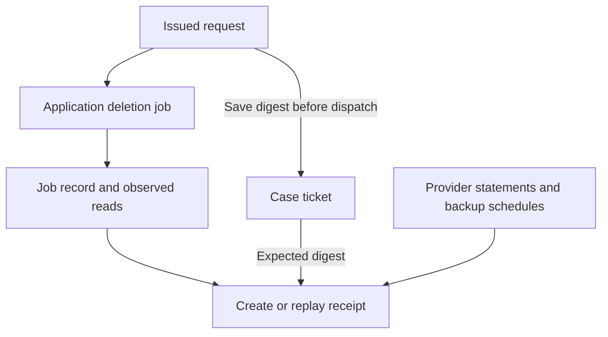

# Axiom

**Test what an AI application can still return after a customer leaves.**

Acme’s offboarding job deletes its support ticket and summary. Both database reads come back empty. Then a worker that read the ticket before deletion saves its answer, and a support agent can retrieve Acme’s summary again. Axiom’s local demo reproduces that failure.

Axiom is an open-source Python CLI for testing tenant offboarding. Your application runs the deletion and supplies the reads. Engineers can use those reads to catch surviving copies in CI. For a specific deletion request, a security or privacy reviewer can replay the receipt offline and see what the team can support in writing.

[Reproduce the delayed write](#a-worker-writes-a-deleted-summary-back) · [Gate your own build](#gate-your-own-build) · [Download the verified CLI and sample evidence](https://github.com/davidahma/axiom/releases/tag/v0.3.2)

## Try a deletion receipt

You’ll need Python 3.11+ and Make. The example uses the Python standard library, a temporary SQLite database and fictional customer records. You can run it offline once you have the source.

```sh
git clone https://github.com/davidahma/axiom.git
cd axiom
make receipt-example
```

The example issues a request, runs the deletion job and verifies the receipt. Its findings include these four lines.

```text
Technical verdict PASS
PROVIDER_REPORTED provider provider_statement issuer=fixture-provider
SCHEDULED backups retention_schedule issuer=fixture-backups expires_on=2030-01-31
Review status OPEN_ITEMS
```

Before offboarding, the observer found both tenants’ tickets and cached answers. Afterward, both lookups for the departing tenant came back empty while the retained tenant’s records stayed visible. The provider reports deleting its own copy. The backup operator supplied an expiry date. The receipt keeps backup deletion open even after that date passes.

Open `artifacts/receipt-example.zip` to inspect the original request, policy, job evidence, exhibits and receipt.

<details>
<summary>Replay the receipt as a reviewer</summary>

For this local example, set the shell variable `EXPECTED_REQUEST_SHA256` to the digest printed when the request was issued. For a customer case, get that value from the original ticket. From the checkout, use the standalone CLI to repeat the review.

```sh
python3 -m zipfile -e artifacts/receipt-example.zip artifacts/review
(
  cd artifacts/review || exit 3
  python3 ../axiom.pyz verify-receipt --request request.json --expect-request "$EXPECTED_REQUEST_SHA256" \
    --policy policy.json --evidence evidence.json --receipt receipt.json \
    --record provider.json provider.txt --record backups.json backups.txt
)
```

Expect `Receipt verified. Replay matches the supplied receipt.` and exit **2**. The reviewer reproduced the open backup item. For the downloadable sample, the release notes supply its request digest. [Release files and replay command](https://github.com/davidahma/axiom/releases/tag/v0.3.2) · [Verify the release files](SECURITY.md#verify-a-release-download)

</details>

## Gate your own build

In the SQLite example, the offboarding job removes Acme’s ticket but skips the answer cache. Run it from the repository root.

```sh
python3 examples/sqlite/observe.py --case residual --output artifacts/observations.json
python3 -m axiom_demo gate --policy examples/sqlite/policy.json \
  --observations artifacts/observations.json --output artifacts/decision.json
```

```text
PASS source tickets after_offboarding
FAIL cache cached_answers after_offboarding after_subject_present
Gate FAIL
```

The gate exits **1**. Rerun both commands with `--case clean` on the observer and both checks pass (exit 0). With `--case unavailable`, the cache reader loses its connection and the gate returns `INCONCLUSIVE` (exit 2).

To integrate Axiom, commit a policy naming each required read, who performs it, which records it looks up and when it runs. Your test reads both the departing tenant and a retained tenant before and after the real job. If the reader loses access to both, the empty result for the departing tenant is inconclusive. For a queue or worker, also record whether the **same job** captured input before deletion and finished afterward. An immediate empty result can miss a later write.

Pass the expected run ID and tested revision from CI with `--expect-run` and `--expect-revision`. Keep the decision, policy and observations together. A reviewer can rerun the gate from those files without access to the application. Vector indexes, agent memory and logs each need a read from your own system. The verdict covers the records, roles and checkpoints in your policy. [Policy and observation formats](docs/gate.md) · [Working observer](examples/sqlite/observe.py)

| Exit | CI gate | Deletion receipt |
| --- | --- | --- |
| 0 | `PASS` · The subject was absent and the control stayed visible at each required checkpoint. | `READY_FOR_REVIEW` · Checks passed and every required provider statement reports deletion. |
| 1 | `FAIL` · A required read found the departing tenant’s data after confirmed offboarding. | `RESIDUAL_FOUND` · The receipt names the read that found it. |
| 2 | `INCONCLUSIVE` · A required read, control or checkpoint lacks evidence. | `OPEN_ITEMS` · A technical check or external record still needs attention. |
| 3 | Invalid invocation, input or output. | Invalid invocation, input, output or replay. |

A confirmed leftover takes precedence over an inconclusive read elsewhere. Only exit 0 passes the CI gate.

## Tie the evidence to one deletion request

A clean run for the right build could still belong to the wrong customer request. Before dispatch, use `request` to issue a fresh manifest for the policy, build, run ID and required exhibits. Save its SHA-256 digest in the original case ticket.



The application records the request digest with the deletion job. The SQLite example commits the deletions and the job record in one transaction. Its observer reads back that job record. At review time, `receipt` checks the job evidence and exhibit files. A second reviewer runs `verify-receipt` with the digest from the ticket. Swapping in evidence for a different request fails even if the build and run ID match.

The examples use staging data. For a customer case, the reviewer checks who collected the observations, which systems and retention obligations they cover, and who issued each provider statement. The reviewer can sign the receipt with OpenSSH and attach it to the deletion response. [Request and receipt guide](docs/receipts.md) · [Deletion certificates and GDPR context](docs/receipts.md#why-a-vendor-might-attach-this-to-a-certificate) · [Handling private evidence](SECURITY.md#receipt-trust-and-privacy)

## What the application tests found

### A worker writes a deleted summary back

Run `python3 -m axiom_demo demo` to exercise a background worker, SQLite and an HTTP support endpoint. In the broken case the worker restores Acme’s summary and the agent retrieves it. The corrected writer checks the workspace’s active flag and generation inside the transaction that saves the summary. When the generation has changed, it discards the stale write. A third case loses the agent’s baseline read and returns `INCONCLUSIVE`.

The demo succeeds when it reproduces all three outcomes. It saves the observations in `artifacts/demo-report.json`. Run `python3 -m axiom_demo validate artifacts/demo-report.json` to recompute the verdicts. [Worker implementation](axiom_demo/fixture.py) · [Evidence format](docs/evidence.md)

### A support agent loses access to the deleted workspace

The Docker trial runs the published OpenDesk v0.4.13 support application with two synthetic workspaces. Its deletion endpoint returned HTTP 204. A read-only database observer then found Acme’s source message and ticket summary absent. The support agent could still retrieve Birch’s summary. The corresponding read for Acme returned HTTP 400 because the workspace context was unavailable.

Both storage probes passed. The failed agent read left application visibility inconclusive, and both summary jobs had finished before deletion, so worker overlap was untested. The gate returned `INCONCLUSIVE` overall. [Published decision](https://github.com/davidahma/axiom/releases/download/v0.3.2/opendesk-decision.json) · [Reproduce the Docker trial](trials/opendesk/README.md) · [Trial image security review](trials/opendesk/README.md#trial-image-review)

## Development

Run `make check` to execute the tests, reproduce the delayed-write cases, build the standalone CLI and replay the sample receipt. GitHub Actions also runs the OpenDesk trial against its pinned images. [CI runs](https://github.com/davidahma/axiom/actions/workflows/checks.yml) · [Contributing](CONTRIBUTING.md) · [Report a security issue](SECURITY.md#report-a-vulnerability) · [Apache License 2.0](LICENSE)
