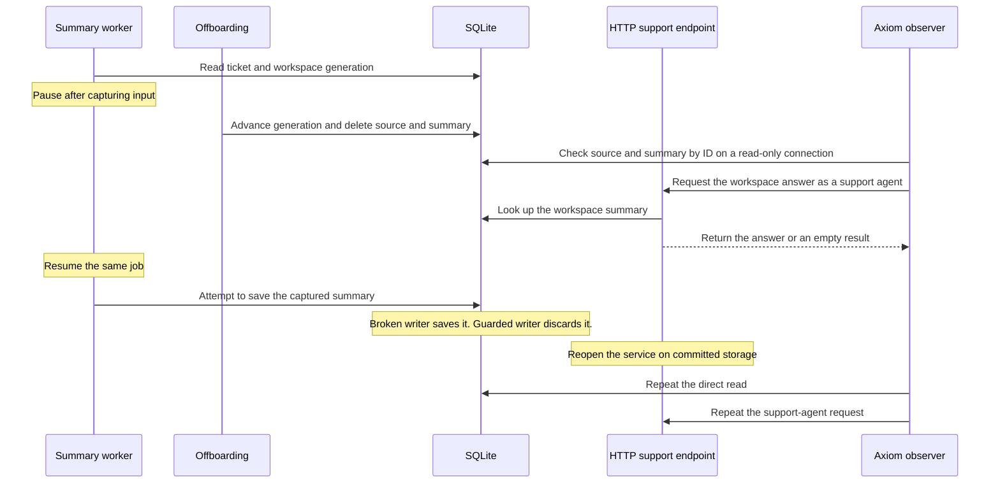

# Axiom

**Show what happened to a customer's data after a specific deletion request.**

A support vendor offboards a customer. The ticket is gone, the answer cache is clear, and a provider says it removed its copy. A backup is still waiting to expire. What can the vendor sign?

Axiom ties a deletion job to the original request and gives the reviewer a receipt they can replay offline. The receipt shows what the application actually read, what a provider reported, and what remains open. Teams can also use the same checks in CI to catch data that survives an offboarding change.

## Try a deletion receipt

Run this from a fresh clone with Python 3.11+ and Make. The example uses a temporary SQLite database and synthetic documents. It needs no account, model key, or cloud service.

```sh
git clone https://github.com/davidahma/axiom.git
cd axiom
make receipt-example
```

| What the example records | Result |
| --- | --- |
| The departing tenant's ticket and cached answer disappeared. The same reads still found the retained tenant's records. | **Technical checks passed** |
| A fictional downstream provider supplied a statement saying it removed its copy. | **Provider-reported deletion** |
| The backup operator supplied a scheduled expiry date. | **Open item** |

The final receipt says **OPEN_ITEMS**. A reviewer can unpack `artifacts/receipt-example.zip`, read the original exhibits and reproduce that conclusion. A clean run from a different request is rejected even when the build and CI run ID match. The case owner saves a fresh digest before dispatch, and the example observer reads that binding back from the committed deletion job.

[Review a receipt and integrate your job](docs/receipts.md) · [Download the standalone CLI and example](https://github.com/davidahma/axiom/releases/tag/v0.3.0)

## Try the gate

This example runs on Python 3.11+ with the standard library. It creates a disposable SQLite database, offboards Acme, and leaves a cached answer behind.

```sh
python3 examples/sqlite/observe.py --case residual --output artifacts/run.json
python3 -m axiom_demo gate --policy examples/sqlite/policy.json --observations artifacts/run.json
```

```text
PASS source tickets after_offboarding
FAIL cache cached_answers after_offboarding after_subject_present
Gate FAIL
```

The gate exits **1**. Run the two Python commands again with `--case clean` to see both reads pass (exit **0**). With `--case unavailable`, the cache reader loses its connection. The source still passes and the gate reports `INCONCLUSIVE` (exit **2**). Invalid input or a run identity mismatch exits **3**.

## Gate your own build

1. Commit a policy naming each required surface, read scope, and checkpoint. Include the copies your application can actually return, such as a support summary or answer cache.
2. In your integration test, seed a departing tenant and a retained control. Read both before and after your usual offboarding job. Export only their observed states and the tested run and revision. An `after_worker` check also needs evidence that the same worker captured input before deletion and finished afterward.
3. Run Axiom in CI. A known leftover blocks the release even when another read is inconclusive. Omitting a required probe also blocks release.

Download `axiom.pyz` and run it from your application's checkout with Python 3.11+. Supply run and revision values from CI so an old observation file cannot pass a new build. [Release download and checksum](https://github.com/davidahma/axiom/releases/tag/v0.3.0)

```sh
python3 axiom.pyz gate --policy ci/offboarding-policy.json \
  --observations "$RUN_DIR/observations.json" --output "$RUN_DIR/decision.json" \
  --expect-run "$TEST_RUN_ID" --expect-revision "$TESTED_REVISION"
```

The evidence comes from your test harness. A passing decision covers its named reads at its recorded checkpoints. Copies outside the policy, backups, physical erasure, and future writes need separate evidence. The decision includes SHA-256 digests of both inputs so a reviewer can replay it. [Integration guide and JSON contract](docs/gate.md) · [Working SQLite producer](examples/sqlite/) · [CI runs](https://github.com/davidahma/axiom/actions/workflows/checks.yml)

## Reproduce a delayed write

A worker reads Acme’s ticket before deletion and saves its summary afterward. In Axiom's deliberately broken support system the summary comes back while the ticket stays deleted. A version check at the write boundary changes the outcome.

From the Axiom checkout, run the three worker cases.

```sh
python3 -m axiom_demo demo
```

`make demo` runs the same command. It creates a temporary SQLite database for each case, starts a loopback HTTP support endpoint, and runs a real background worker. The demo needs no packages, cloud account, Docker daemon, or model key. It writes [versioned JSON](docs/evidence.md) to `artifacts/demo-report.json`.

| Reference case | Immediately after offboarding | After the held worker finishes and the service reopens | Verdict |
| --- | --- | --- | --- |
| Broken writer | Acme’s source and summary are absent. The agent gets no answer. | The source is still absent. The summary exists again and the agent retrieves it. | **FAIL** |
| Guarded writer | Same immediate observations. | The worker discards the stale write. Both rows stay absent and the agent gets no answer. | **PASS** |
| Missing read permission | Storage checks succeed. The agent’s pre-deletion read lacked a valid credential. | The worker discards the write. The missing baseline leaves the support check unresolved. | **INCONCLUSIVE** |

The command exits successfully when it reproduces all three expected outcomes, including the specific failure. It preserves that failure in the report. A changed failure pattern makes the command exit unsuccessfully.

### Why the summary comes back

Both writers read the same source, capture the same workspace generation, and compute the same summary. Offboarding advances the generation and removes Acme’s source and summary in one transaction. The corrected writer checks the workspace is still active **and** still has the captured generation *inside the same transaction that would save the summary*. The broken writer saves the captured answer without that final check.



The fixture uses events to establish execution order. Sleeps and wall-clock timestamps would leave open whether the worker ever exercised the intended path. The observer also knows the expected synthetic answer marker and omits it from the HTTP request. [Worker and transaction](axiom_demo/fixture.py) · [Independent verdict logic](axiom_demo/report.py)

## Independent application trial

We also ran a normal workspace offboarding against **opendesk v0.4.13**, a separately maintained support application. The trial uses its published container, PostgreSQL, two synthetic workspaces, the application’s native summary and deletion endpoints, and a deterministic local model substitute. The model supplies synthetic text. opendesk handles authorization, persistence, and workspace removal. [Pinned upstream source](https://github.com/useopendesk/opendesk/tree/e0012447924c5ac8a13a51d2cd41a6496bc26fb3)

| Observation | Before deletion | After opendesk accepted Acme’s deletion |
| --- | --- | --- |
| Acme source message and stored ticket summary, read by record ID | Both present | Both absent from the queried records |
| Acme summary through the same support agent | Returned | **Inconclusive.** The application returned HTTP 400 because the workspace was no longer available to that read. |
| Birch source, summary, and support read | Present and returned | Still present and returned |
| Worker overlapping upstream deletion | — | **Not tested.** Both upstream summary requests completed before deletion. |

The trial completed its offboarding procedure. The portable policy gives it **INCONCLUSIVE** overall. Both storage probes passed, the support-agent read was unavailable, and the worker overlap was untested. CI checks all four findings.

Run the independent trial with Python and Docker Compose.

```sh
python3 trials/opendesk/run.py --report artifacts/opendesk.json
```

The first run downloads pinned images. The runner creates and removes its own disposable Compose project. The observed results above apply to the named rows, role, endpoints, and observation window. Backup contents, other copies, and later writes remain outside that scope. [Reproduction notes](trials/opendesk/README.md) · [Recorded run](trials/opendesk/observed.json)

## Verify or contribute

```sh
make check
python3 -m axiom_demo validate artifacts/demo-report.json
```

`make check` tests the gate, builds the portable CLI, exercises it outside the checkout, and replays the reference cases. The validation command checks the evidence format and recomputes each verdict from the recorded observations. GitHub Actions also exercises the pinned upstream trial and scans the repository history for secrets. See [contributing](CONTRIBUTING.md) and [security reporting](SECURITY.md).

Axiom focuses on one end-to-end offboarding decision. For broader RAG lifecycle and index-race testing, see [RecallFSCK](https://github.com/sanketsinghai/recallfsck). For an example of gating changes to a deletion worker, see [AfterDelete](https://gitlab.com/aidash-group1/afterdelete). Each project documents the reach of its own checks.

[Apache License 2.0](LICENSE)
