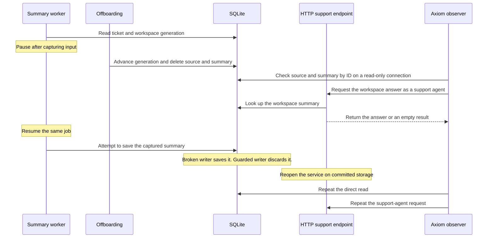

# Axiom

**Does a customer's AI-generated support summary disappear when the customer leaves?**

A support engineer deletes Acme’s workspace. The ticket is gone. Its summary is gone. The support agent can no longer retrieve it. Then a worker that read the ticket *before* deletion finishes. In Axiom’s deliberately broken reference system, the summary comes back. The ticket stays deleted.

Axiom is a runnable tenant-offboarding case study. It checks the source row, the derived summary, and the answer visible to a support agent at distinct points in time. A second workspace, Birch, stays active so that an outage or an empty database cannot pass for successful cleanup.

[Run the demo](#run-the-demo) · [Independent application trial](#independent-application-trial) · [Read the evidence](docs/evidence.md) · [CI runs](https://github.com/davidahma/axiom/actions/workflows/checks.yml)

## Run the demo

You need Python 3.11 or newer with its standard library. From a fresh clone:

```sh
git clone https://github.com/davidahma/axiom.git
cd axiom
python3 -m axiom_demo demo
```

`make demo` runs the same command. It creates a temporary SQLite database for each case, starts a loopback HTTP support endpoint, and runs a real background worker. The demo needs no packages, cloud account, Docker daemon, or model key. It writes [versioned JSON](docs/evidence.md) to `artifacts/demo-report.json`.

| Reference case | Immediately after offboarding | After the held worker finishes and the service reopens | Verdict |
| --- | --- | --- | --- |
| Broken writer | Acme’s source and summary are absent. The agent gets no answer. | The source is still absent. The summary exists again and the agent retrieves it. | **FAIL** |
| Guarded writer | Same immediate observations. | The worker discards the stale write. Both rows stay absent and the agent gets no answer. | **PASS** |
| Missing read permission | Storage checks succeed. The agent’s pre-deletion read lacked a valid credential. | The worker discards the write. The missing baseline leaves the support check unresolved. | **INCONCLUSIVE** |

The command exits successfully when it reproduces all three expected outcomes, including the specific failure. It preserves that failure in the report. A changed failure pattern makes the command exit unsuccessfully.

## The decision that changes the result

Both writers read the same source, capture the same workspace generation, and compute the same summary. Offboarding advances the generation and removes Acme’s source and summary in one transaction. The corrected writer checks the workspace is still active **and** still has the captured generation *inside the same transaction that would save the summary*. The broken writer saves the captured answer without that final check.



The fixture uses events to establish execution order. Sleeps and wall-clock timestamps would leave open whether the worker ever exercised the intended path. The observer also knows the expected synthetic answer marker and omits it from the HTTP request. [Worker and transaction](axiom_demo/fixture.py) · [Independent verdict logic](axiom_demo/report.py)

## Independent application trial

We also ran a normal workspace offboarding against **opendesk v0.4.13**, a separately maintained support application. The trial uses its published container, PostgreSQL, two synthetic workspaces, the application’s native summary and deletion endpoints, and a deterministic local model substitute. The model supplies synthetic text. opendesk handles authorization, persistence, and workspace removal. [Pinned upstream source](https://github.com/useopendesk/opendesk/tree/e0012447924c5ac8a13a51d2cd41a6496bc26fb3)

| Observation | Before deletion | After opendesk accepted Acme’s deletion |
| --- | --- | --- |
| Acme source message and stored ticket summary, read by record ID | Both present | Both absent from the queried records |
| Acme summary through the same support agent | Returned | **Inconclusive.** The application returned HTTP 400 because the workspace was no longer available to that read. |
| Birch source, summary, and support read | Present and returned | Still present and returned |
| Worker overlapping upstream deletion | — | **Not tested.** Both upstream summary requests completed before deletion. |

Run the independent trial with Python and Docker Compose:

```sh
python3 trials/opendesk/run.py --report artifacts/opendesk.json
```

The first run downloads pinned images. The runner creates and removes its own disposable Compose project. The observed results above apply to the named rows, role, endpoints, and observation window. Backup contents, other copies, and later writes remain outside that scope. [Reproduction notes](trials/opendesk/README.md) · [Recorded run](trials/opendesk/observed.json)

## Verify or contribute

```sh
make check
python3 -m axiom_demo validate artifacts/demo-report.json
```

`make check` runs the regression tests, repeats the reference demo, and validates its report. The validation command checks the evidence format and recomputes each verdict from the recorded observations. GitHub Actions also exercises the pinned upstream trial and scans the repository history for secrets. See [contributing](CONTRIBUTING.md) and [security reporting](SECURITY.md).

Axiom focuses on one end-to-end offboarding decision. For broader RAG lifecycle and index-race testing, see [RecallFSCK](https://github.com/sanketsinghai/recallfsck). For an example of gating changes to a deletion worker, see [AfterDelete](https://gitlab.com/aidash-group1/afterdelete). Each project documents the reach of its own checks.

[Apache License 2.0](LICENSE)
